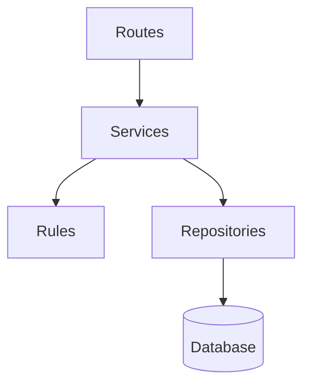
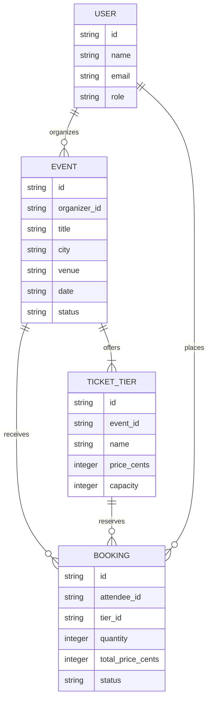
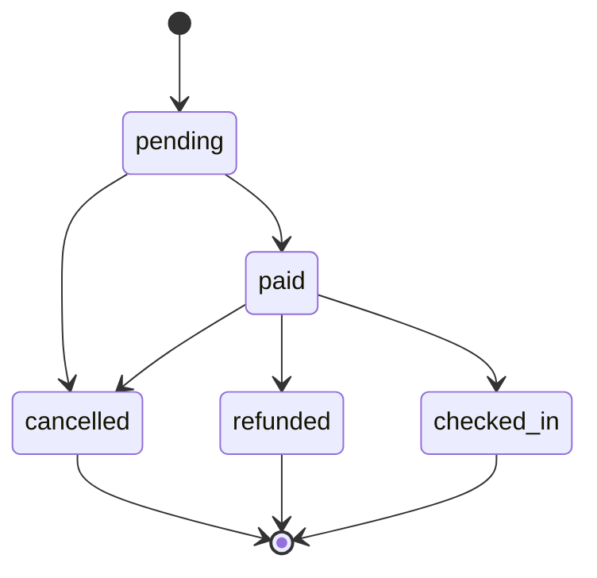

# Build 3 Architecture

## Layers

- **Routes** translate HTTP requests and responses; they may call services but may not contain business rules or access data directly.
- **Services** coordinate use cases; they may call domain rules and repositories but may not handle HTTP details or call routes.
- **Rules** enforce pure domain behavior; they may not perform I/O or depend on services, routes, or repositories.
- **Data** is accessed through repositories; repositories may read and write persistence but may not call business rules, services, or routes.

## Data model

## Booking life cycle

The terminal states are `cancelled`, `refunded`, and `checked_in`; no transitions leave them.
