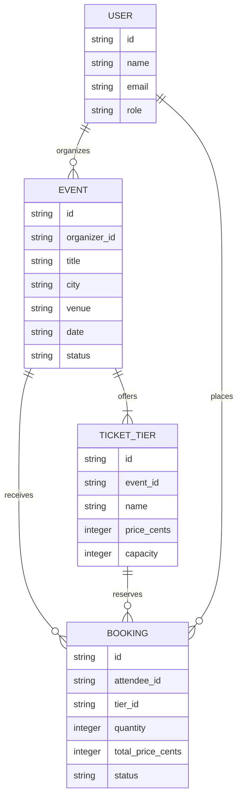
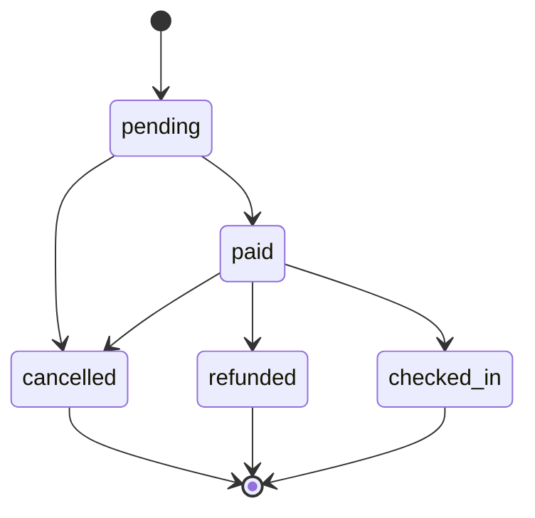

# Build 3 Architecture

## Layers

```drawio
<mxfile>
  <diagram id="bQChIWF0adU3x-P3AW0y" name="Page-1">
    <mxGraphModel dx="437" dy="540" grid="1" gridSize="10" guides="1" tooltips="0" connect="1" arrows="1" fold="1" page="1" pageScale="1" pageWidth="850" pageHeight="1100" math="0" shadow="0">
      <root>
        <mxCell id="PxB_cCf_j8EHOicpMum_-0" />
        <mxCell id="PxB_cCf_j8EHOicpMum_-1" parent="PxB_cCf_j8EHOicpMum_-0" />
        <UserObject label="" mermaidData="{&#xa;  &quot;data&quot;: &quot;flowchart TD\r\n  Routes --&gt; Services\r\n  Services --&gt; Rules\r\n  Services --&gt; Repositories\r\n  Repositories --&gt; Data[(Database)]&quot;,&#xa;  &quot;config&quot;: null&#xa;}" id="MvemPRe2q5MMN3AVk072-0">
          <mxCell connectable="0" parent="PxB_cCf_j8EHOicpMum_-1" style="group;transparentBounds=1;editIcon=1;lockedGroup=0;groupPadding=10;" vertex="1">
            <mxGeometry as="geometry" />
          </mxCell>
        </UserObject>
        <UserObject label="Routes" mermaidId="n:Routes" mermaidBaseStyle="html=1;whiteSpace=wrap;strokeWidth=1;fillColor=light-dark(#ECECFF,#1f2020);strokeColor=light-dark(#9370DB,#cccccc);fontColor=light-dark(#333333,#cccccc);fontFamily=Trebuchet MS,Verdana,Arial,sans-serif;fontSize=16;" mermaidBaseValue="Routes" id="PxB_cCf_j8EHOicpMum_-2">
          <mxCell parent="MvemPRe2q5MMN3AVk072-0" style="html=1;whiteSpace=wrap;strokeWidth=1;fillColor=light-dark(#ECECFF,#1f2020);strokeColor=light-dark(#9370DB,#cccccc);fontColor=light-dark(#333333,#cccccc);fontFamily=Trebuchet MS,Verdana,Arial,sans-serif;fontSize=16;" vertex="1">
            <mxGeometry height="54" width="108" x="91" y="10" as="geometry" />
          </mxCell>
        </UserObject>
        <UserObject label="Services" mermaidId="n:Services" mermaidBaseStyle="html=1;whiteSpace=wrap;strokeWidth=1;fillColor=light-dark(#ECECFF,#1f2020);strokeColor=light-dark(#9370DB,#cccccc);fontColor=light-dark(#333333,#cccccc);fontFamily=Trebuchet MS,Verdana,Arial,sans-serif;fontSize=16;" mermaidBaseValue="Services" id="PxB_cCf_j8EHOicpMum_-3">
          <mxCell parent="MvemPRe2q5MMN3AVk072-0" style="html=1;whiteSpace=wrap;strokeWidth=1;fillColor=light-dark(#ECECFF,#1f2020);strokeColor=light-dark(#9370DB,#cccccc);fontColor=light-dark(#333333,#cccccc);fontFamily=Trebuchet MS,Verdana,Arial,sans-serif;fontSize=16;" vertex="1">
            <mxGeometry height="54" width="118" x="86" y="114" as="geometry" />
          </mxCell>
        </UserObject>
        <UserObject label="Rules" mermaidId="n:Rules" mermaidBaseStyle="html=1;whiteSpace=wrap;strokeWidth=1;fillColor=light-dark(#ECECFF,#1f2020);strokeColor=light-dark(#9370DB,#cccccc);fontColor=light-dark(#333333,#cccccc);fontFamily=Trebuchet MS,Verdana,Arial,sans-serif;fontSize=16;" mermaidBaseValue="Rules" id="PxB_cCf_j8EHOicpMum_-4">
          <mxCell parent="MvemPRe2q5MMN3AVk072-0" style="html=1;whiteSpace=wrap;strokeWidth=1;fillColor=light-dark(#ECECFF,#1f2020);strokeColor=light-dark(#9370DB,#cccccc);fontColor=light-dark(#333333,#cccccc);fontFamily=Trebuchet MS,Verdana,Arial,sans-serif;fontSize=16;" vertex="1">
            <mxGeometry height="54" width="98" x="10" y="218" as="geometry" />
          </mxCell>
        </UserObject>
        <UserObject label="Repositories" mermaidId="n:Repositories" mermaidBaseStyle="html=1;whiteSpace=wrap;strokeWidth=1;fillColor=light-dark(#ECECFF,#1f2020);strokeColor=light-dark(#9370DB,#cccccc);fontColor=light-dark(#333333,#cccccc);fontFamily=Trebuchet MS,Verdana,Arial,sans-serif;fontSize=16;" mermaidBaseValue="Repositories" id="PxB_cCf_j8EHOicpMum_-5">
          <mxCell parent="MvemPRe2q5MMN3AVk072-0" style="html=1;whiteSpace=wrap;strokeWidth=1;fillColor=light-dark(#ECECFF,#1f2020);strokeColor=light-dark(#9370DB,#cccccc);fontColor=light-dark(#333333,#cccccc);fontFamily=Trebuchet MS,Verdana,Arial,sans-serif;fontSize=16;" vertex="1">
            <mxGeometry height="54" width="147" x="158" y="218" as="geometry" />
          </mxCell>
        </UserObject>
        <UserObject label="Database" mermaidId="n:Data" mermaidBaseStyle="html=1;shape=cylinder3;boundedLbl=1;backgroundOutline=1;size=10;strokeWidth=1;whiteSpace=wrap;fillColor=light-dark(#ECECFF,#1f2020);strokeColor=light-dark(#9370DB,#cccccc);fontColor=light-dark(#333333,#cccccc);fontFamily=Trebuchet MS,Verdana,Arial,sans-serif;fontSize=16;" mermaidBaseValue="Database" id="PxB_cCf_j8EHOicpMum_-6">
          <mxCell parent="MvemPRe2q5MMN3AVk072-0" style="html=1;shape=cylinder3;boundedLbl=1;backgroundOutline=1;size=10;strokeWidth=1;whiteSpace=wrap;fillColor=light-dark(#ECECFF,#1f2020);strokeColor=light-dark(#9370DB,#cccccc);fontColor=light-dark(#333333,#cccccc);fontFamily=Trebuchet MS,Verdana,Arial,sans-serif;fontSize=16;" vertex="1">
            <mxGeometry height="67" width="81" x="191" y="322" as="geometry" />
          </mxCell>
        </UserObject>
        <UserObject label="" mermaidId="e:Routes-&gt;Services#0" mermaidBaseStyle="curved=1;startArrow=none;endArrow=block;endSize=7;strokeColor=light-dark(#333333,#cccccc);exitX=0.5;exitY=1;entryX=0.5;entryY=0;" mermaidBaseValue="" id="PxB_cCf_j8EHOicpMum_-7">
          <mxCell edge="1" parent="MvemPRe2q5MMN3AVk072-0" source="PxB_cCf_j8EHOicpMum_-2" style="curved=1;startArrow=none;endArrow=block;endSize=7;strokeColor=light-dark(#333333,#cccccc);exitX=0.5;exitY=1;entryX=0.5;entryY=0;" target="PxB_cCf_j8EHOicpMum_-3">
            <mxGeometry relative="1" as="geometry">
              <Array as="points" />
            </mxGeometry>
          </mxCell>
        </UserObject>
        <UserObject label="" mermaidId="e:Services-&gt;Rules#0" mermaidBaseStyle="curved=1;startArrow=none;endArrow=block;endSize=7;strokeColor=light-dark(#333333,#cccccc);exitX=0.12;exitY=1;entryX=0.5;entryY=0;" mermaidBaseValue="" id="PxB_cCf_j8EHOicpMum_-8">
          <mxCell edge="1" parent="MvemPRe2q5MMN3AVk072-0" source="PxB_cCf_j8EHOicpMum_-3" style="curved=1;startArrow=none;endArrow=block;endSize=7;strokeColor=light-dark(#333333,#cccccc);exitX=0.12;exitY=1;entryX=0.5;entryY=0;" target="PxB_cCf_j8EHOicpMum_-4">
            <mxGeometry relative="1" as="geometry">
              <Array as="points">
                <mxPoint x="59" y="193" />
              </Array>
            </mxGeometry>
          </mxCell>
        </UserObject>
        <UserObject label="" mermaidId="e:Services-&gt;Repositories#0" mermaidBaseStyle="curved=1;startArrow=none;endArrow=block;endSize=7;strokeColor=light-dark(#333333,#cccccc);exitX=0.88;exitY=1;entryX=0.5;entryY=0;" mermaidBaseValue="" id="PxB_cCf_j8EHOicpMum_-9">
          <mxCell edge="1" parent="MvemPRe2q5MMN3AVk072-0" source="PxB_cCf_j8EHOicpMum_-3" style="curved=1;startArrow=none;endArrow=block;endSize=7;strokeColor=light-dark(#333333,#cccccc);exitX=0.88;exitY=1;entryX=0.5;entryY=0;" target="PxB_cCf_j8EHOicpMum_-5">
            <mxGeometry relative="1" as="geometry">
              <Array as="points">
                <mxPoint x="232" y="193" />
              </Array>
            </mxGeometry>
          </mxCell>
        </UserObject>
        <UserObject label="" mermaidId="e:Repositories-&gt;Data#0" mermaidBaseStyle="curved=1;startArrow=none;endArrow=block;endSize=7;strokeColor=light-dark(#333333,#cccccc);exitX=0.5;exitY=1;entryX=0.51;entryY=0;" mermaidBaseValue="" id="PxB_cCf_j8EHOicpMum_-10">
          <mxCell edge="1" parent="MvemPRe2q5MMN3AVk072-0" source="PxB_cCf_j8EHOicpMum_-5" style="curved=1;startArrow=none;endArrow=block;endSize=7;strokeColor=light-dark(#333333,#cccccc);exitX=0.5;exitY=1;entryX=0.51;entryY=0;" target="PxB_cCf_j8EHOicpMum_-6">
            <mxGeometry relative="1" as="geometry">
              <Array as="points" />
            </mxGeometry>
          </mxCell>
        </UserObject>
      </root>
    </mxGraphModel>
  </diagram>
</mxfile>

```

- **Routes** translate HTTP requests and responses; they may call services but may not contain business rules or access data directly.
- **Services** coordinate use cases; they may call domain rules and repositories but may not handle HTTP details or call routes.
- **Rules** enforce pure domain behavior; they may not perform I/O or depend on services, routes, or repositories.
- **Data** is accessed through repositories; repositories may read and write persistence but may not call business rules, services, or routes.

## Data model



## Booking life cycle



The terminal states are `cancelled`, `refunded`, and `checked_in`; no transitions leave them.
